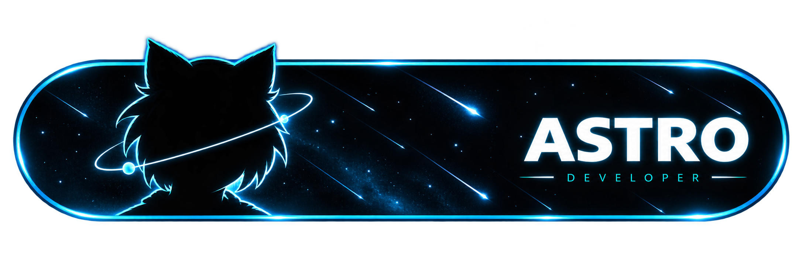
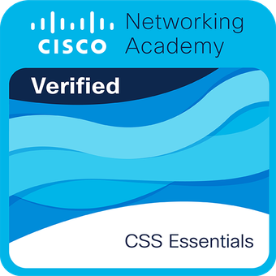

  <a href="./README.md">ESPAÑOL</a> • <a href="./README.en.md">ENGLISH</a>

  

---

#  A little about me

<table width="100%">
  <tr>
    <td width="60%">
      

         <strong>I'm a Full Stack Developer</strong> 
        Specialized in building full-cycle experiences using Java and Angular.
      

      

         <strong>Lifelong learner and curious by nature</strong> 
        Constantly exploring new technologies to build scalable solutions.
      

      

         <strong>Driven by passion for projects</strong> 
        I research repositories and develop projects to solve everyday problems.
      

      

         <strong>Fun fact</strong> 
        I love cats. That explains Neco-Arc typing non-stop right next to this!
      

    </td>
    <td width="40%" align="center" valign="middle">
      
    </td>
  </tr>
</table>

---

#  Languages and Tools

<table width="100%">
  <tr>
    <td valign="top" width="33%">
      <h3 align="center">Frontend</h3>
      

        
        
        
        
        
        
        
      

    </td>
    <td valign="top" width="33%">
      <h3 align="center">Backend & Mobile</h3>
      

        
        
        
      

       
      <h3 align="center">Cloud & Deployment</h3>
      

        
        
        
      

    </td>
    <td valign="top" width="33%">
      <h3 align="center">Databases</h3>
      

        
        
        
        
      

       
      <h3 align="center">Tools</h3>
      

        
        
        
      

    </td>
  </tr>
</table>

---

#  Other Software

   
  
  
  
  
    

---

#  My GitHub Stats

  
  

---

#  Project Performance

  
Real-time analysis of <b><a href="https://astro-web14.netlify.app/" target="_blank">Astro Web</a></b>

    

  

---

#  My Certifications

  
  
  
  
  
  

---

#  Featured Widgets

###  Music

   
  
   

---

#  Contact Me

  
<i>My current Discord status in case you want to chat...</i>

  
    
 
  <h3><i>Thanks for visiting my profile! Contributing to the counter...</i></h3>
  

  

